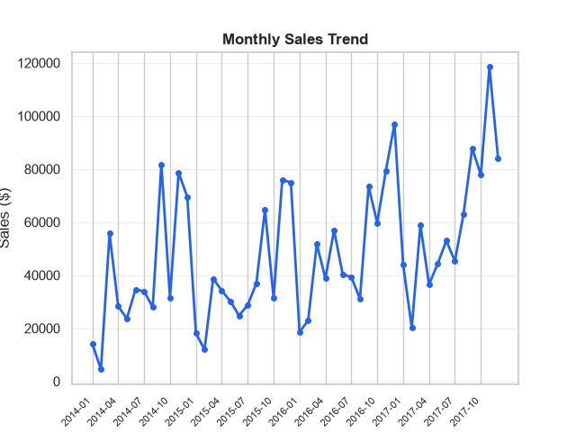
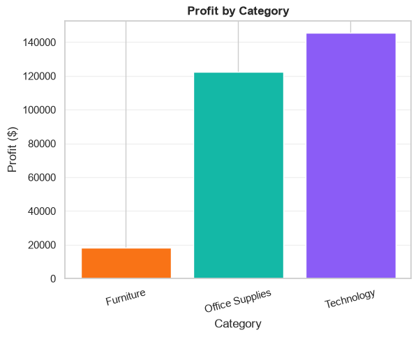
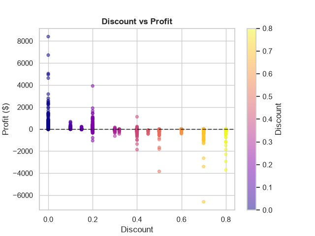

# Superstore Sales Analysis

**A Python and SQL analysis of retail sales data to understand which products, regions, and customer groups generate revenue and profit.**

## 1. Project Overview

The goal of this project is to investigate where a retail business is making money and where it is losing money. The analysis uses Python, Pandas, visualizations, and SQL to explore sales performance, profitability, customer segments, discounts, and trends over time.

## 2. Problem Statement

Sales revenue alone does not show whether a business is profitable. A product or region can generate high sales but relatively low profit, while discounts can increase order volume and still reduce profitability. This project examines sales and profit together so the business can identify strong areas, investigate losses, and make better pricing and sales decisions.

## 3. Dataset

- **Dataset:** Sample Superstore
- **Source:** Kaggle (Sample Superstore dataset, as specified in the project brief)
- **Rows:** 9,994
- **Columns after cleaning:** 24
- **Order date range:** January 3, 2014 – December 30, 2017
- **Total sales:** $2,297,200.86
- **Total profit:** $286,397.02

The dataset contains order and shipping dates, customer and order information, product categories and sub-categories, regions, sales, quantity, discount, and profit. The cleaned dataset also includes `year`, `month`, and `profit_margin` columns.

### Data cleaning and preparation

- Standardized column names to lowercase with underscores.
- Converted `order_date` and `ship_date` to datetime when working in Pandas.
- Checked for missing values and duplicate rows; none were found in the uploaded cleaned dataset.
- Created `year`, `month`, and `profit_margin` features.

## 4. Tools Used

- **Python** – main programming language
- **Pandas** – data cleaning, grouping, and analysis
- **NumPy** – numerical operations
- **Matplotlib** – charts and dashboard layout
- **Seaborn** – statistical visualizations and heatmap
- **SQLite** – relational database and SQL queries
- **Jupyter Notebook / VS Code** – development environment
- **Git and GitHub** – version control and project publishing

## 5. Key Findings

1. **Technology was the strongest product category.** It generated $836,154.03 in sales and $145,454.95 in profit, the highest totals among the three categories.
2. **The sub-category with the most sales was not the one with the most profit.** Phones generated the highest sub-category sales at $330,007.05, while Copiers generated the highest sub-category profit at $55,617.82.
3. **The West was the best-performing region overall.** It generated $725,457.82 in sales and $108,418.45 in profit. Central had the lowest total profit at $39,706.36.
4. **The highest discount group had a large total loss.** Orders with discounts above 40% recorded a combined profit of -$99,558.59. This is an observed relationship in the dataset and does not, by itself, prove that discounts were the only cause of the losses.
5. **Consumer generated the most total sales and profit, while Home Office had the highest profit margin.** Consumer generated $1,161,401.34 in sales and $134,119.21 in profit. Home Office had the highest profit margin at approximately 14.03%.

## 6. Visualizations

The notebook includes six visualizations. Three of them are shown below.

### Monthly sales trend



### Profit by category



### Discount level versus profit



## 7. Business Recommendations

1. **Review high-discount orders.** Investigate products and orders with discounts above 40%, which recorded a combined loss of $99,558.59. Review discount rules and check profitability before approving large discounts.
2. **Investigate loss-making sub-categories.** Tables, Bookcases, and Supplies had negative total profit. Review their pricing, discount patterns, and costs to understand what is driving the losses.
3. **Study regional performance.** Examine why Central generated the lowest regional profit, while the West led in both sales and profit. Compare product mix, discounts, and sales patterns by region.
4. **Use customer-segment results when planning promotions.** Consumer produced the most total profit, while Home Office had the highest profit margin. Consider strategies that support the Consumer segment while testing responsible growth opportunities in Home Office.

## 8. Project Structure

```text
superstore-sales-analysis/
├── README.md
├── requirements.txt
├── data/
│   └── superstore.csv
├── notebooks/
│   └── analysis.ipynb
├── sql/
│   └── queries.sql
├── images/
│   ├── monthly_sales_trend.png
│   ├── profit_by_category.png
│   └── discount_vs_profit.png
└── superstore.db
```

## 9. How to Run the Project

### Requirements

- Python 3.10 or newer
- Jupyter Notebook or VS Code

### Install the libraries

Open a terminal in the project folder and run:

```bash
pip install pandas numpy matplotlib seaborn jupyter
```

SQLite is available through Python's built-in `sqlite3` module, so a separate Python package is not required for SQLite access.

### Run the notebook

1. Download or clone this repository.
2. Open the project folder in VS Code or Jupyter Notebook.
3. Open `notebooks/analysis.ipynb`.
4. Make sure the dataset is located at `data/superstore.csv`.
5. Run the notebook cells from top to bottom.

### Run the SQL queries

Open `superstore.db` using an SQLite-compatible tool, or connect to it with Python's `sqlite3` module. Run the queries saved in `sql/queries.sql`. The database table used by this project is named `superstore`.

## 10. Conclusion

This project shows why a retail business should evaluate both sales and profit. The results identify Technology and the West region as major contributors, highlight loss-making sub-categories and high-discount groups, and show that the most valuable customer segment can differ depending on whether value is measured by total profit or profit margin.
